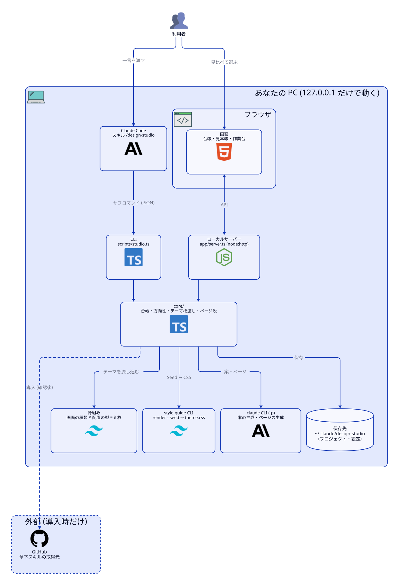
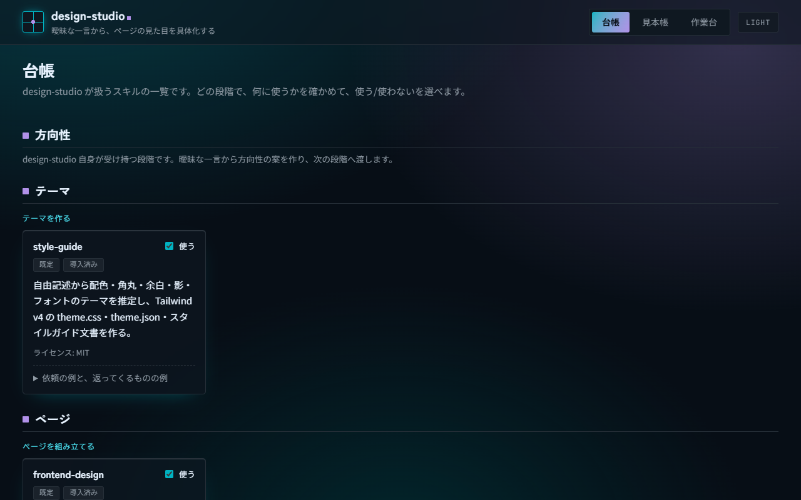
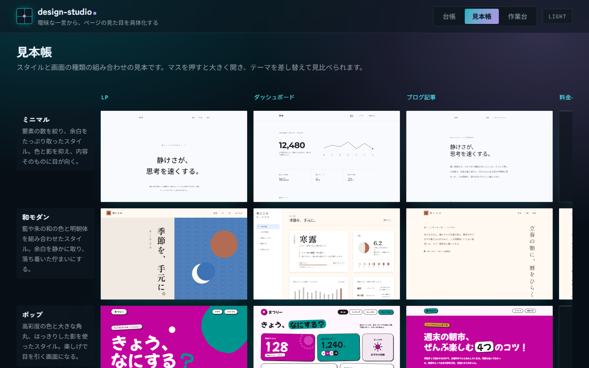
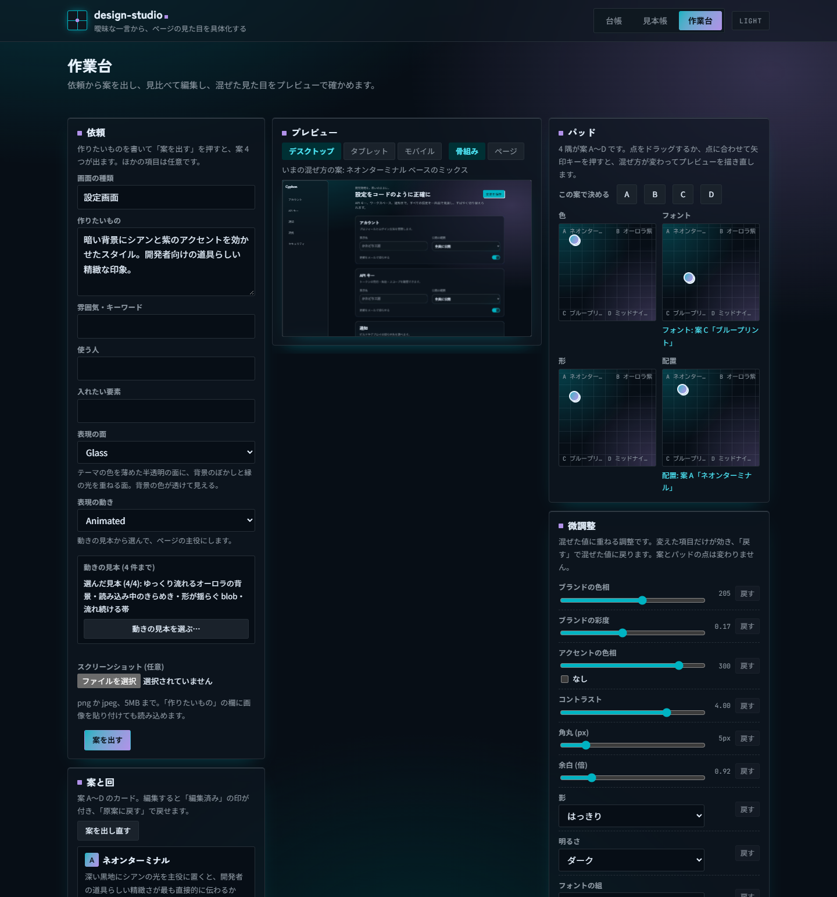
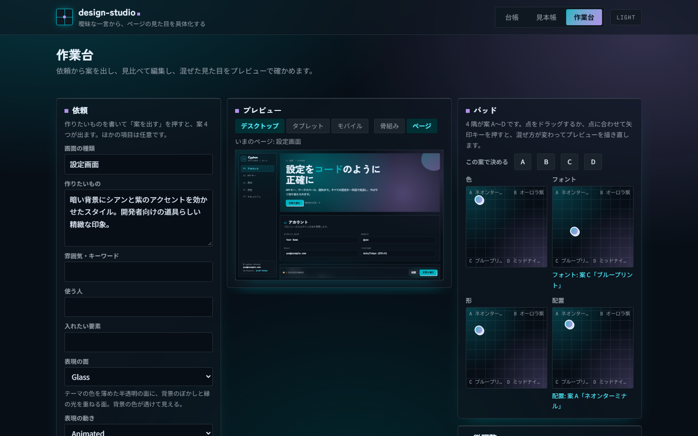
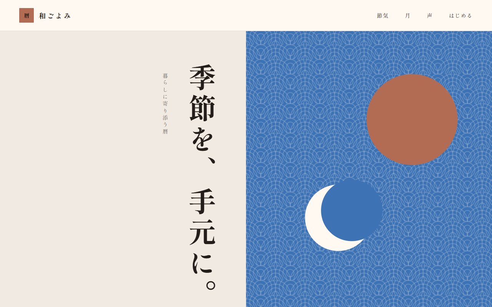

# claude-skill-design-studio

曖昧な依頼 (「なんとなく、落ち着いた感じで」) から、Web ページの見た目を具体化する Claude Code スキル兼ローカル Web アプリです。
方向性の案を 4 つ骨組みで見比べて、選ぶかパッドの点で混ぜて調整し、LLM にページを作らせて保存します。スキルの台帳・見本帳も付いています。
テンプレートに頼らず、デザイン系のスキルを段階ごとに振り分ける親スキルです。

<picture>
  <source media="(prefers-color-scheme: dark)" srcset="docs/architecture/architecture-dark.svg">
  
</picture>

図のソースは `docs/architecture/architecture.d2`。構成が変わったら `python ~/.claude/skills/arch-diagram/versions/v1.1/scripts/render.py docs/architecture/architecture.d2` で描き直します。

## 画面

同梱アプリ (`/design-studio app`) の 3 つの画面です。キャプチャのページ作成は、本物の LLM ではなくテスト用の偽 LLM (`app/mock-llm.mjs`) で撮っているため、できたページは仮の文面です。

**台帳**: 傘下スキルを段階・役割ごとに見て、使う/使わないを選びます。



**見本帳**: スタイル 7 種 × 骨組みの種類の見本 (LP・ダッシュボード・ブログ記事と、見本のある種類。いまは料金ページ) を並べ、大きく開いて見比べます。



**作業台**: 依頼から方向性の案を 4 つ出し、骨組みで見比べて選ぶか、軸ごとのパッドで混ぜます。依頼のフォームでは、表現 (面と動き) も選べます。



**作業台 (ページを作る)**: 決めた方向性で LLM が 1 ファイルのページを作り、別タブで開く・ダウンロードできます。



**見本ページ**: 見本帳の和モダン × LP。外部の画像に頼らず、CSS と SVG だけで描いています。



## 特長

- 言葉になっていないイメージから始められる。方向性の案を 4 つ、テーマと配置の違う骨組みで見比べる
- 色・フォント・形・配置の軸ごとに、4 隅 (A=(0,0)・B=(1,0)・C=(0,1)・D=(1,1)) に案を置いたパッドの点 (0〜1 の x, y) で、混ぜる度合いを選べる
- テーマは style-guide と共通の `theme.css` / `theme.json`。ほかの作業でも使い回せる
- できるページは 1 ファイルの HTML。外部の画像に頼らず、ダブルクリックで開ける
- 点検・仕上げのスキル (アクセシビリティ、講評、文言、動きなど) を台帳から選んで呼べる
- 同梱アプリ (台帳・見本帳・作業台) は手元の PC だけで動く。API キーは要らない

## 必要なもの

- Claude Code
- Node.js 22.18 以上 (`.ts` をそのまま実行するため。開発は v26)
- 任意: 傘下スキル (style-guide、design プラグインなど)。足りなければ design-studio が計画を示して導入する

## インストール

開発用リポジトリを clone してから、自己インストールのスクリプトを実行します。

```sh
git clone https://github.com/reeschan/claude-skill-design-studio.git ~/dev/claude-skill-design-studio
cd ~/dev/claude-skill-design-studio
node scripts/install-self.ts
```

`~/.claude/skills/design-studio/` へ、スキルとして使う分 (CLI・同梱アプリ・台帳・スタイル・ページのレシピ) だけが写ります。テストや開発用のファイルは写りません。

- 写し先は環境変数 `DESIGN_STUDIO_INSTALL_DIR` で変えられます
- 写し直しは、目印 `.design-studio-install` のある置き先だけ。目印の無いディレクトリには書かず、終了コード 2 で止まります
- リポジトリを直したあとは、同じコマンドをもう一度実行すると写し直せます

## 使い方

Claude Code で呼び出します。

```text
/design-studio 落ち着いた感じの請求書 SaaS の LP
```

依頼から、方向性の案 (骨組み) → テーマ → ページ → 点検の順に進みます。ほかの呼び方:

- `/design-studio app`: 同梱アプリ (台帳・見本帳・作業台) をブラウザで開く
- `/design-studio catalog`: 台帳 (傘下スキルの段階・役割・導入状態) を見る
- `/design-studio add <owner/skill>`: ui-skills.com から傘下スキルを台帳に足す
- `/design-studio install`: 足りない傘下スキルを入れる

CLI を直接使うこともできます。

```sh
node ~/.claude/skills/design-studio/scripts/studio.ts styles
node ~/.claude/skills/design-studio/scripts/studio.ts treatments
node ~/.claude/skills/design-studio/scripts/studio.ts treatments motion spinning-border --out motion.html
node ~/.claude/skills/design-studio/scripts/studio.ts render-direction --direction direction.json --family lp --surface glass --out skeleton.html
```

- `treatments`: 面 4 つと動きの見本 12 件の一覧
- `treatments motion <id> --out <file>`: 動きの見本 1 件を HTML に書く (省くと `html` を返す)
- `render-direction --surface <id>`: 骨組みに面の CSS を重ねる (動きは入れない)

## できあがるもの

- **ページ**: 1 ファイルの HTML。外部から読み込むのは Tailwind v4 のブラウザ版と Google Fonts だけで、画像は CSS と SVG で表します
- **テーマ**: style-guide が作る `theme.css` (Tailwind v4 の変数) と `theme.json`
- **プロジェクト**: `~/.claude/design-studio/projects/<id>/` に、依頼・方向性・テーマ・ページを保存します

## 開発

スキルとして使うだけなら不要です。開発には pnpm で検査用の道具を入れます。

```sh
pnpm install
pnpm check   # lint・書式・型・テストをまとめて通す
```

テストでは、style-guide や `claude` CLI は偽物に差し替わるので、本物は要りません。

アプリを手元で動かすには (偽の LLM を使うなら API キーも要りません):

```sh
fnm exec --using=26 node app/server.ts --port 8790 --no-browser
# 偽の LLM で動かす: DESIGN_STUDIO_LLM_CMD='["<node の絶対パス>","<リポジトリ>/app/mock-llm.mjs"]'
```

構成:

- `app/`: ローカルの Web アプリ (サーバーと画面)
- `core/`: 台帳・導入・方向性・テーマの橋渡し・ページの殻・プロジェクト・LLM 呼び出し (純粋な処理)
- `skeletons/`: 骨組みの種類 × 配置の型の骨組み
- `scripts/`: CLI (`studio.ts` と `scripts/commands/`)、自己インストール (`install-self.ts`)
- `data/`: 台帳 (`catalog.json`) とスタイル (`styles.json`)
- `gallery/`: 見本ページ
- `docs/`: アーキテクチャ図 (`docs/architecture/`)・画面のキャプチャ (`docs/images/`)・仕様 (`docs/specs/design-studio.md`)・設計判断 (`docs/adr/`)・ページのレシピ (`docs/page-recipe.md`)

## ライセンス

MIT (`LICENSE` を参照)。フォントは各フォントのライセンス (Google Fonts の OFL など) に従います。
